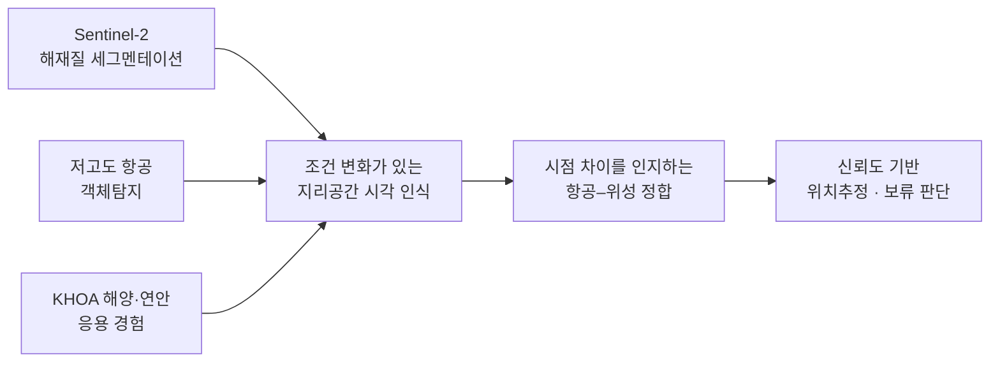

# Aerial–Satellite Vision Research

> 박사 지원용 연구계획서 탐색 — 항공·위성 영상의 cross-view alignment, temporal change, reliable localization

이 저장소는 **커리큘럼이나 학습 로드맵이 아니라**, 지원자의 선행 이력과 최신 연구 지형을 바탕으로 “어떤 박사 연구주제가 가장 설득력 있는가”를 검증·정리하는 연구계획서 공간입니다.

## Current recommendation

**Change-Aware Cross-View Alignment for Reliable UAV-to-Map Localization**  
**시점 차이를 인지하는 항공–위성 크로스뷰 정합과 신뢰도 기반 위치추정**

핵심은 단순히 드론 영상에서 위성 지도를 검색하는 것이 아닙니다. 정합 실패가 발생했을 때 그것이 잘못된 위치 때문인지, 지도·영상의 시간 차이로 인한 실제 변화 때문인지, 혹은 시점 차이 때문인지를 구분하고, 불확실할 때는 신뢰도와 변화 근거를 함께 제시하는 비전 시스템을 연구합니다.

## Research narrative

이 흐름은 “위성 연구를 하다가 나중에 항공으로 전환”하는 계획이 아닙니다. 처음부터 항공 영상과 위성 지도 사이의 시점·시야·센서 차이를 다루는 하나의 박사 연구축을 세웁니다.

## Why this direction

- **연속성:** Sentinel-2 해재질 세그멘테이션, 저고도 항공 객체탐지, 해양 프로젝트 경험을 하나의 “항공·지리공간 영상에서의 조건 변화와 인지” 축으로 연결합니다.
- **진로 적합성:** CV와 항공전자/자율비행 문제를 함께 다루되, 위성·원격탐사 랩에도 연구 언어가 통합니다.
- **차별성:** 단순 cross-view retrieval은 이미 경쟁이 치열하므로, 시간적 지도 불일치와 정합 불확실성의 분리·보정을 연구 공백으로 삼습니다.
- **지원 전략:** 교토대 Ken Sakurada 교수의 change detection / 3D modelling / remote sensing 접점이 가장 가깝지만, 실제 박사 지도 가능 여부와 소속 그룹 구조는 지원 전에 반드시 직접 확인해야 합니다.

## Repository map

- [PhD research-plan assessment](reports/2026-11-11-phd-research-plan.md) — 후보 주제 비교, 최종 주제, 연구 질문, 지원 전략, 근거 출처
- `weekly/` — 다음 주부터 갱신될 주간 연구지형 점검. 새 논문·데이터셋·랩 적합도가 현재 연구계획서의 가설을 바꾸는지 추적합니다.

## Evidence standard

사실, 저자 주장, 지원자 맞춤 해석을 구분합니다. 공식 논문·프로젝트·대학 페이지를 우선으로 하며, 확인하지 못한 지도 가능 여부·모집 가능성·성능 수치는 사실처럼 기록하지 않습니다.
